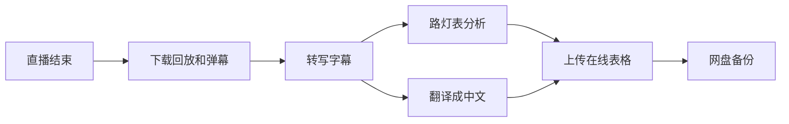

<div align="center">

# Kiri Agent

**给切片组用的直播素材助手**

自动下载直播回放，生成中文字幕和「路灯表」，帮你快速找到值得剪的片段。

[](https://github.com/anson70242/Kiri_Agent/actions/workflows/ci.yml)

[](LICENSE)

</div>

## 📖 简介

Kiri Agent 会盯着主播的频道，直播一结束就自动下载回放，转写成字幕并翻译成中文，
再整理出一张「路灯表」：把整场直播按时间分段，写明每一段聊了什么、值不值得剪。
处理好的内容可以自动同步到在线表格和网盘，方便大家分工。最后剪什么，仍然由人决定。

## ✨ 功能

- 📡 **直播监控**：定时检查 YouTube / Twitch / TwitCasting 上的主播有没有开播
- 🔔 **通知**：开播、下播和处理结果发到 Discord 和 QQ 群，每个群可以自己选主播和通知类型
- ⬇️ **自动下载**：直播结束后自动下载回放和弹幕，每位主播只保留最近几场
- 💬 **字幕**：语音转写成原文字幕，再翻译成中文，可以在线对照观看或下载 SRT
- 🏮 **路灯表**：用 LLM 为每个时间段写话题摘要并打分，结合弹幕热度标出高光片段
- 🖥️ **网页**：查看直播状态、录播和路灯表，管理通知和用户账号
- 📊 **在线表格**：路灯表自动上传到腾讯文档，录播的下载链接也可以自动登记到表格
- ☁️ **网盘备份**：处理完的录播打包上传到夸克网盘长期保存，并生成分享链接
- ⚡ **QQ 闪传**：处理完的录播自动传成 QQ 闪传，处理完成的通知直接给闪传链接，国内的剪辑下载更快
- 📁 **群文件归档**：QQ 群里发的文件，按文件名规则自动存到网盘对应的文件夹

## 🔄 工作流程



每一步失败都会自动重试，结果会在 Discord 上报告。

## 🚀 快速开始

### 环境要求

- Python 3.13+
- [uv](https://docs.astral.sh/uv/)
- ffmpeg

### 安装

```sh
git clone https://github.com/anson70242/Kiri_Agent.git
cd Kiri_Agent
uv sync
cp .env.example .env    # 再填入要用到的值
```

### 运行

```sh
uv run -m backend.monitor.server
```

然后打开 <http://127.0.0.1:8770>。

各个步骤也可以单独手动运行，例如：

```sh
uv run -m backend.monitor --once      # 查一次谁在直播
uv run -m backend.downloader <链接>   # 下载一场回放和弹幕
```

> 转写需要跑在 GPU 上的 whisper 服务，分析和翻译需要 LLM 的 key，都在配置里设置。
> 其余命令见 [docs/reference.md](docs/reference.md)。

## 🖥️ 网页

| 页面 | 用途 |
| --- | --- |
| 直播状态 | 谁在直播、谁开了待机室；新增主播，设置每位主播的自动下载、自动上传和网盘备份 |
| 录播 | 已下载的录播和处理进度；在线播放（带字幕和弹幕），下载影片、字幕、路灯表或整包 |
| 路灯表 | 每场录播的路灯表，可以按分数和弹幕热度筛选 |
| 通知 | Discord 和 QQ 机器人的状态；每个 QQ 群订阅的主播和通知类型 |
| 用户 | 开启登录后，管理员在这里管理账号 |

## ⚙️ 配置

| 位置 | 内容 |
| --- | --- |
| `config.json` | 可以提交到仓库的设置：监控、通知、LLM、转写、下载、上传、网盘等 |
| `.env` | 密钥和 token，参考 [.env.example](.env.example) |
| `data/` | 在网页上改的设置和运行中的状态；部署不会动这个文件夹 |

## 🗂️ 项目结构

```
backend/     后端：监控、通知、下载、转写、分析、翻译、上传、网盘
frontend/    网页
services/    whisper 转写服务
tests/       测试
docs/        文档
```

## 🧪 测试

```sh
uv run pytest                     # 离线测试，跳过较慢的压力测试
uv run pytest -m "not network"    # 全部离线测试，CI 跑的就是这个
uv run ruff check                 # 代码检查
```

## 📦 部署

推送到 main 后，CI 先跑测试，通过了就自动部署到服务器（Docker）。
网页默认只在内网可见，也可以开启登录后通过 HTTPS 对外公开。

服务器的安装步骤和各项功能的开启方法见 [docs/deploy.md](docs/deploy.md)。

## 📚 文档

| 文档 | 内容 |
| --- | --- |
| [docs/deploy.md](docs/deploy.md) | 服务器安装、部署和日常操作，各项功能的开启方法 |
| [docs/reference.md](docs/reference.md) | 每个功能的详细说明（英文） |
| [docs/monitor-limitations.md](docs/monitor-limitations.md) | 直播监控做不到的事 |
| [GLOSSARY.md](GLOSSARY.md) · [docs/adr/](docs/adr/) | 项目用词和设计决定（英文） |

## 📄 许可证

本项目以 [AGPL-3.0](LICENSE) 发布。你可以自由使用、修改和分发；
但如果把修改后的版本作为网络服务提供给别人，也必须公开它的源代码。

路灯表分析和翻译用的提示词改编自 [AutoKiri](https://github.com/anson70242/AutoKiri)，同样是 AGPL-3.0。
